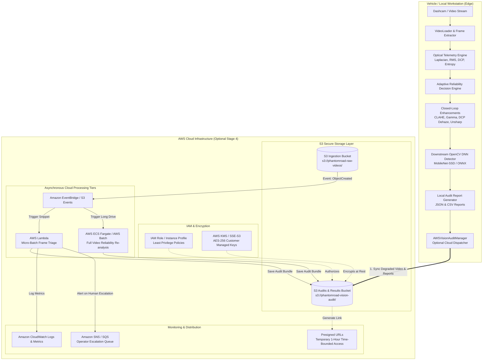
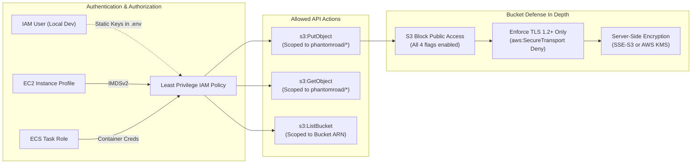

# PhantomRoad — Cloud Processing Architecture (Stage 4)
### Optional AWS Hybrid Deployment Architecture & Telemetry Pipeline

---

## 1. Architectural Overview & Philosophy

PhantomRoad uses a **hybrid edge-first architecture** designed for autonomous vehicles, dashcams, and Advanced Driver Assistance Systems (ADAS):

1. **Edge-First Local Autonomy (Default Mode)**:
   - Frame ingestion, Pech-Pacheco Laplacian variance, RMS contrast, Dark Channel Prior dehazing, tone correction, and MobileNet-SSD downstream detection run **100% locally** in real-time ($< 30\text{ms}$ per frame).
   - Zero dependency on external network connectivity or cloud APIs for immediate vehicle safety decisions.
   - **Local Mode is the strict system default**: If AWS credentials or S3 bucket variables are missing, PhantomRoad operates completely offline with zero network calls and zero cloud charges.

2. **Optional AWS Cloud Synchronization (Stage 4)**:
   - When configured, provides asynchronous cloud synchronization for:
     - Archiving degraded video incidents and near-misses.
     - Storing immutable, cryptographically verifiable audit reports (`audit_report.json`, `audit_report.csv`, `manifest.json`).
     - Asynchronous fleet analytics, re-training pipeline ingestion, and compliance reviews.
     - Secure stakeholder sharing via time-bounded presigned URLs (no public bucket exposure).

---

## 2. End-to-End System Architecture Diagram



---

## 3. Data Flow & Component Breakdown

### A. Edge Dashcam & Local Agent
- **Ingestion**: Decodes video frames at native framerate (e.g. 24–60 FPS).
- **Evaluation**: Computes optical quality metrics ($Laplacian$, $RMS\ Contrast$, $Dark\ Channel$, $Grid\ Entropy$).
- **Selective Cloud Sync**: Rather than blindly uploading continuous gigabytes of clear driving footage, the edge agent can selectively upload **only degraded frames, critical obstructions, or safety escalations**, reducing cloud egress and storage costs by $> 95\%$.

### B. AWS S3 Storage Hierarchy
Assets in the S3 bucket are organized into deterministic, auditable prefixes:

```
s3://phantomroad-vision-audit/
├── phantomroad/
│   ├── audits/
│   │   ├── run_20261018_120000/
│   │   │   ├── manifest.json            # Complete audit run manifest with checksums
│   │   │   ├── audit_report.json        # Frame-by-frame quantitative telemetry
│   │   │   ├── audit_report.csv         # Tabular metrics for BI / analytics
│   │   │   └── processed_feed.mp4       # Video snippet associated with the run
│   ├── frames/
│   │   ├── frame_00001_raw.jpg          # Original degraded frame snapshot
│   │   ├── frame_00001_enhanced.jpg     # Agent-corrected frame snapshot
│   │   └── frame_00001_diff.jpg         # Pixel intensity difference heatmap
│   └── jobs/
│       └── job-a1b2c3d4/
│           └── job_request.json         # Queued cloud processing job event
```

### C. The Manifest Document (`manifest.json`)
Every uploaded bundle includes an immutable manifest linking all artifacts:

```json
{
  "manifest_version": "1.0",
  "run_id": "run_20261018_120000",
  "timestamp_utc": "2026-10-18T12:00:00.000000Z",
  "bucket": "phantomroad-vision-audit",
  "bundle_prefix": "phantomroad/audits/run_20261018_120000/",
  "summary_stats": {
    "total_frames_analyzed": 30,
    "reliable_frames": 27,
    "degraded_corrected": 2,
    "human_escalations": 1,
    "recovery_rate": 0.90
  },
  "artifacts": {
    "json_report": "s3://phantomroad-vision-audit/phantomroad/audits/run_20261018_120000/audit_report.json",
    "csv_report": "s3://phantomroad-vision-audit/phantomroad/audits/run_20261018_120000/audit_report.csv",
    "video": "s3://phantomroad-vision-audit/phantomroad/audits/run_20261018_120000/processed_feed.mp4",
    "manifest": "s3://phantomroad-vision-audit/phantomroad/audits/run_20261018_120000/manifest.json"
  },
  "encryption": "AES256",
  "presigned_download_links": {
    "json_report": "https://phantomroad-vision-audit.s3.amazonaws.com/...token=...",
    "video": "https://phantomroad-vision-audit.s3.amazonaws.com/...token=..."
  }
}
```

---

## 4. Compute Tiers & Execution Models

| Compute Tier | Use Case | Latency | Trigger | Cost Model |
| :--- | :--- | :--- | :--- | :--- |
| **Edge / Local (Default)** | In-cabin real-time ADAS perception | $< 30\text{ms}$ / frame | Continuous video stream | **$0.00** (Local hardware) |
| **AWS Lambda** | Asynchronous triage of short incident clips ($< 30\text{s}$) | $1 - 3\text{s}$ spin-up | S3 `s3:ObjectCreated` event | Per-millisecond execution |
| **AWS ECS Fargate** | Headless batch processing of long drive logs (hours) | $30 - 60\text{s}$ spin-up | SQS Queue / EventBridge | Per-vCPU/GB-hour |
| **Amazon Athena** | Serverless SQL queries across thousands of CSV audits | $2 - 5\text{s}$ query | Ad-hoc analytics query | $5.00 per TB scanned |

---

## 5. Security & Isolation Architecture



1. **Zero Hardcoded Secrets**: Credentials are never placed in source code or committed to git.
2. **Temporary Scoped Access**: Uses IAM Roles or STS `assume_role` whenever running in the cloud.
3. **No Public S3 Buckets**: Public access is blocked at the bucket and account level. External downloads use short-lived presigned URLs.
